# ASML Is Building a Hybrid Bonding Tool!

> **출처**: [SemiAnalysis Newsletter](https://newsletter.semianalysis.com/p/asml-is-building-a-hybrid-bonding)
> **저자**: Sherry Zhang, Gerald Wong, Steven Lee, Dylan Patel
> **발행일**: 2026-10-15

## 📑 목차

1. [ASML이 하이브리드 본더를 만든다](#s1)
2. [수직 통합의 연장선](#s2)
3. [트랙 위를 달리는 장비](#s3)
4. [ASML이 우위를 잡을 수 있는 곳](#s4)
5. [ASML이 풀어야 할 네 가지 과제](#s5)
6. [Besi에 더해지는 압박](#s6)

## 🔑 용어 정리

> - **하이브리드 본딩(HB)**: 두 칩의 구리 패드와 절연막을 땜납 없이 직접 붙이는 접합 방식. 칩 사이 연결 간격을 크게 줄인다
> - **D2W와 W2W**: D2W(die-to-wafer)는 잘라 낸 칩을 웨이퍼 위에 하나씩 얹는 방식, W2W(wafer-to-wafer)는 웨이퍼 통째로 맞붙이는 방식
> - **트랙과 홀더**: 트랙은 칩을 실은 작은 운반대(홀더)가 공정 장치 앞을 차례로 지나가게 하는 레일
> - **정렬 정확도(오버레이)**: 위아래 칩의 패드가 얼마나 정확히 겹쳐 놓이는지. 어긋나면 접합이 불량이 된다
> - **파티클 제어**: 접합면에 먼지가 앉지 않게 하는 관리. 먼지 하나가 넓은 면적을 들뜨게 한다
> - **피드포워드 계측**: 앞 공정에서 잰 위치를 뒤 공정이 그대로 믿고 쓰는 방식. 접합 단계에서는 칩 너머를 볼 수 없어 이 방식에 기댄다
> - **본드 웨이브**: 칩 중앙이 먼저 닿은 뒤 가장자리로 번지며 공기를 밀어내는 접합 진행 파동
> - **ISO 클래스**: 공기 중 먼지 허용 수준의 등급. 숫자가 작을수록 깨끗하다

---

<a id="s1"></a>

## 1. ASML이 하이브리드 본더를 만든다

**📌 핵심:**
- ASML은 아직 아무것도 발표하지 않았지만, 특허·언론 보도·자사 로드맵이 모두 하이브리드 본딩 장비 개발을 가리킴
- 첫 제품은 칩을 웨이퍼에 하나씩 얹는 D2W 방식일 것으로 추정 (웨이퍼 통째 접합보다 어렵지만 ASML이 우위를 잡을 수 있는 영역)
- 첫 고객은 이미 D2W가 양산 중인 첨단 로직이고, 로직 매출 비중이 큰 Besi에는 악재
- 하이브리드 본딩은 SemiAnalysis가 2024년 심층 분석에서 EUV 이후 반도체 제조의 가장 큰 변화로 꼽았고, 지금도 같은 판단
- 결론: 장비는 2030년 이후에나 나오지만, Besi의 성장 전망에 이미 압박

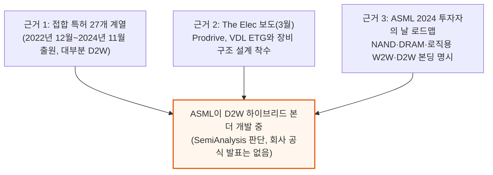

### 지금 어디까지 왔나

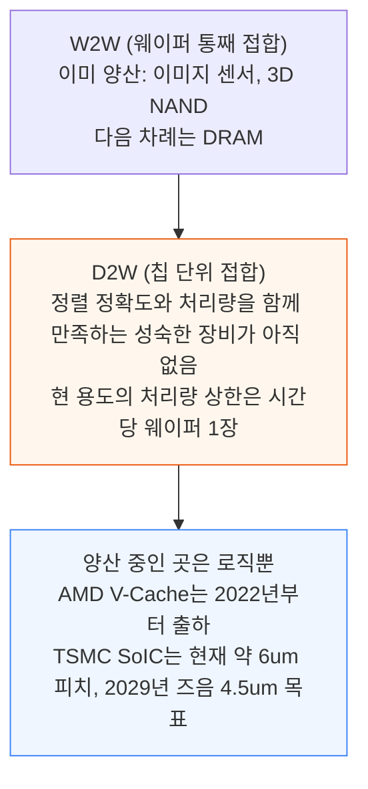

시장은 2028년부터 HBM이 D2W의 대형 물량 동력이 될 것으로 기대해 왔다. SemiAnalysis의 판단은 다르다. HBM은 2029년 전에는 D2W 하이브리드 본딩을 쓰지 않을 것이고, 끝내 안 쓸 수도 있다.

Besi는 D2W를 이끌어 왔고 양산 라인에 장비가 들어간 유일한 공급사다. 나머지는 첫 장비의 고객 인증을 받으려 애쓰는 중이다. 그러나 ASML이 D2W 장비를 만들고 있어 이 구도가 곧 바뀔 것으로 본다.

경영진은 아무 발표도 하지 않았다. 2024년 11월 이후 출원분은 아직 공개 전이라 실제 특허 수는 27개 계열보다 많을 가능성이 크다.

### 기준 특허가 그린 장비

기준 특허(WO2025201788A1)에 그려진 접합 흐름은 전통적인 D2W 본더와 전혀 다르다. 기존 장비는 본드 헤드가 잘린 웨이퍼에서 칩을 하나씩 집어 올려 얹는다. ASML은 칩 하나하나를 독립된 홀더에 실어 트랙 위로 돌린다.

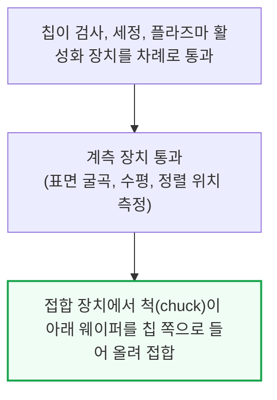

설계의 세부는 3절에서 푼다. 이 글의 Fig 1은 이 트랙형 본더의 구성도(ASML 출처, SemiAnalysis가 단순화해 주석)이며, 위 흐름도가 그 요지다.

**W2W 장비도 만들 가능성이 있다.** 인하대의 특허 분석에 따르면 ASML은 웨이퍼 오버레이 정확도를 앞세워 TWINSCAN 플랫폼 위에 W2W 장비도 만드는 것으로 보인다. 이 글은 D2W에 집중한다. 만들기 더 어려운 장비이고, ASML이 실제 우위를 잡을 수 있는 곳이기 때문이다.

<a id="s2"></a>

## 2. 수직 통합의 연장선

**📌 핵심:**
- 본더 개발은 ASML이 광원, 검사, 광학으로 사업을 넓혀 온 수직 통합의 다음 단계
- ASML 자체 로드맵이 이미 본딩을 전공정 흐름 안에 넣었고, 본더와 스캐너가 칩 위치 정보를 공유하는 특허도 있음
- 첫 고객은 첨단 로직으로 예상, ASML은 경쟁사보다 비싸게 팔 것으로 전망
- 결론: 본더와 스캐너를 한 세트로 파는 구조가 목표

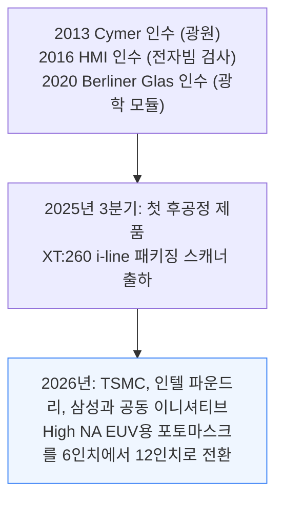

본더는 그다음의 자연스러운 걸음이다. ASML의 2024 투자자의 날 자료는 NAND, DRAM, 로직용 W2W·D2W 하이브리드 본딩을 전공정 3D 통합 지도에 이미 올려 두었다(Fig 2).

### 본더와 스캐너가 위치 정보를 나눈다

2024년 7월 출원 특허가 둘의 협업 방식을 보여 준다. 지금은 접합된 웨이퍼 위에 회로를 찍는 스캐너가 노광 전에 칩 하나하나를 사전 정렬하고 대략 정렬해야 한다.

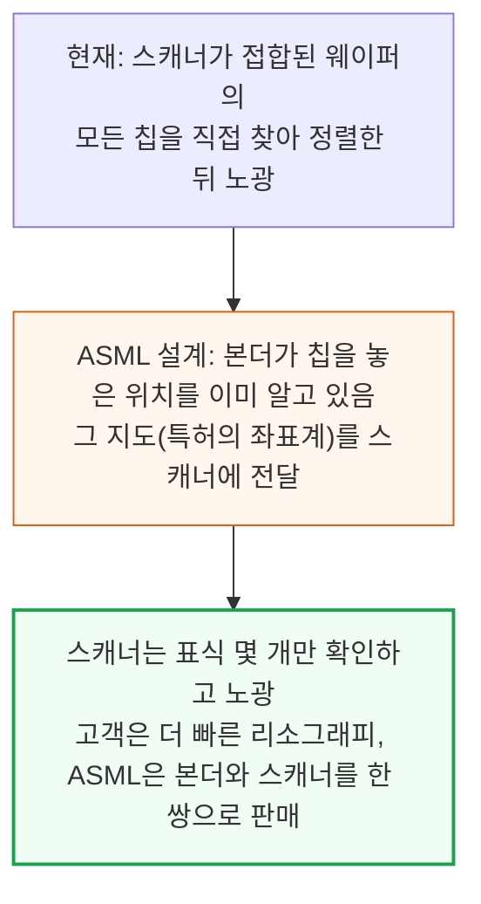

### 첫 고객은 첨단 로직

첨단 로직이 가장 먼저 도입할 것으로 본다. 이미 D2W가 양산 중이고, 정렬 요구 수준이 계속 높아지는 영역이다.

TSMC는 SoIC에서 오버레이가 "늘 가장 큰 과제"라고 말한다. 하이브리드 본딩 피치가 2029년까지 6um에서 4.5um로 줄면 배치 정확도 요구는 더 올라간다.

ASML은 정렬에 강하다(4절). 그래서 로직 고객부터 확보할 가능성이 크다. 첨단 로직 칩은 가장 비싼 칩에 속해 고객이 비싼 장비를 감당할 수 있다. 장비 가격은 경쟁사보다 높게 매길 것으로 예상한다.

이어지는 세 절은 ① 트랙 시스템(시중 장비와 가장 다른 점), ② 정렬·파티클 제어·구동에서 ASML의 강점, ③ 작동하는 장비를 위해 풀어야 할 과제를 다룬다.

<a id="s3"></a>

## 3. 트랙 위를 달리는 장비

**📌 핵심:**
- 이 장비의 가장 큰 특징은 칩이 자기 홀더에 실려 트랙을 따라 공정 장치 앞을 지나간다는 점
- 기존 Besi형 장비는 칩을 따로 준비해 두었다가 마지막 얹는 순간에만 본드 헤드가 집어 올림
- 장치마다 처리 시간에 맞춰 개수를 정할 수 있어 가동률이 오르고, 중복 장비가 줄며, 칩 종류가 달라도 한 라인에 올릴 수 있음
- 결론: 장치 배치를 소프트웨어로 바꿀 수 있는 라인이지만, 비접합 장치 개조와 청정도가 숙제

ASML은 특허에서 SuperTrak CONVEYANCE(Fig 3, HORIZON10 플랫폼)를 예로 든다. 그래서 이 트랙을 쓴다고 가정하고 트랙의 공개 설계를 기준으로 분석한다.

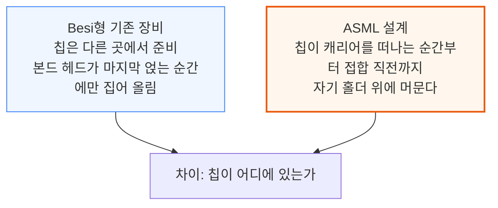

공정 장치는 트랙 둘레에 놓인다. 칩이 장치 앞에 서면 장치가 그 자리에서 세정, 활성화, 측정을 하고 칩은 다음으로 간다.

### 단계별 흐름

특허 도면(Fig 4)에 SemiAnalysis가 장치 이름을 붙였다. 그립퍼가 캐리어에서 칩을 집어 빈 기판 홀더(206)에 얹고, 홀더가 트랙(202)을 따라 칩을 운반한다.

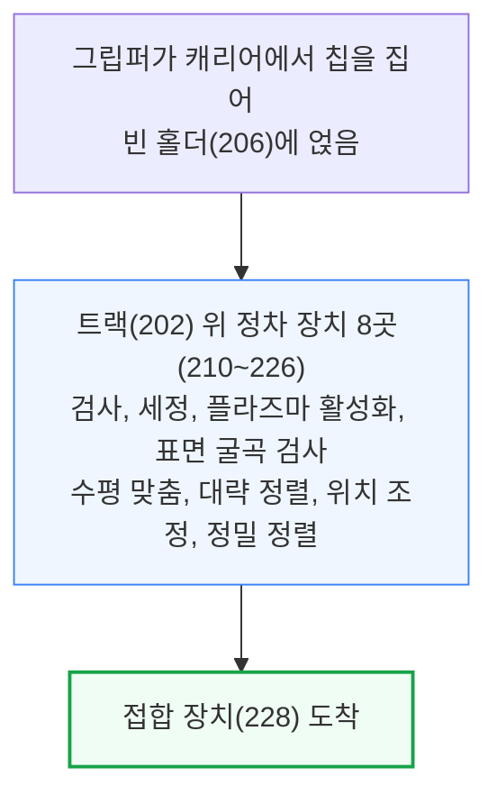

특허에서는 칩이 장치로 들어가는 오늘의 흐름과 반대로, 장치의 센서나 헤드가 칩 쪽으로 움직여 다가간다.

### 접합 장치의 구조

접합 장치에서 최종 배치를 맡는 것은 트랙이 아니라 홀더(206)와 척(234)이다. SuperTrak 사양서는 셔틀 반복 정밀도를 약 10um로 적는데, 접합에 필요한 50nm 배치 정확도와는 거리가 멀다.

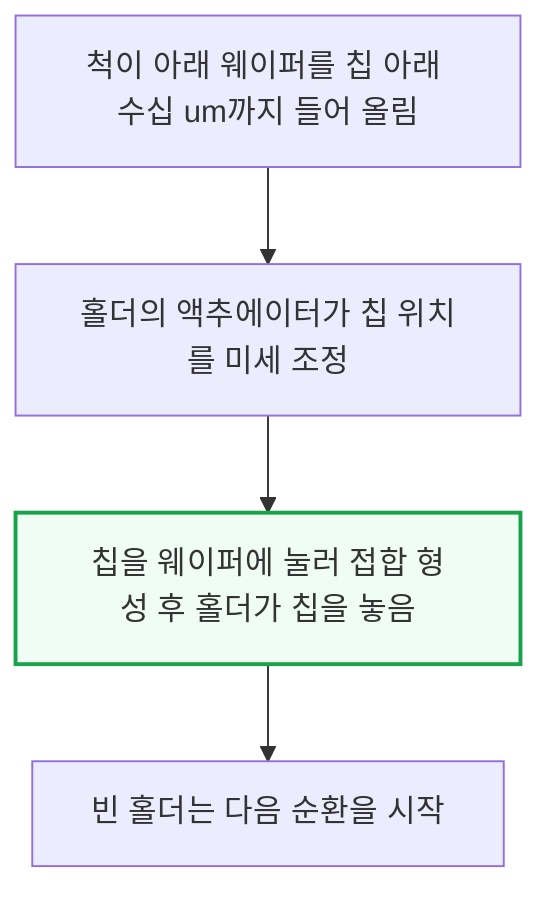

### 세 가지 이점

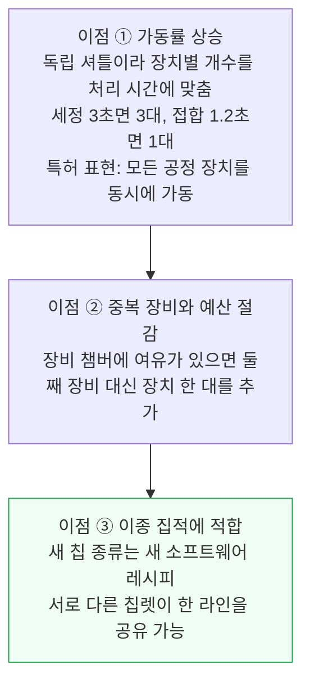

다만 트랙에는 비접합 장치와 루프 전체 청정도라는 과제가 따라온다. 5절에서 다시 다룬다.

<a id="s4"></a>

## 4. ASML이 우위를 잡을 수 있는 곳

**📌 핵심:**
- 하이브리드 본딩 수율은 정렬 정확도와 입자 관리, 두 가지가 정한다 (1um 입자 하나가 약 10mm 폭을 들뜨게 함)
- ASML은 리소그래피에서 같은 두 문제를 수십 년 풀었다
- 정렬은 웨이퍼 정렬 센서 기술(ORION)을, 오차 여유는 스캐너급 스테이지 정밀도(0.9nm)를, 구동은 Prodrive와 VDL ETG를 활용
- 결론: 우위는 정렬과 청정도에서 나올 것으로 보지만, 접합 결과가 아니라 리소그래피 실적에 근거한 추정

### 왜 정렬과 청정도인가

원문의 Fig 5처럼, 두께가 온전한 두 웨이퍼 사이의 1um 입자 하나는 약 10mm 폭의 접합 면을 들뜨게 해 불량 접합을 만든다. 그래서 입자 관리가 극도로 중요하다.

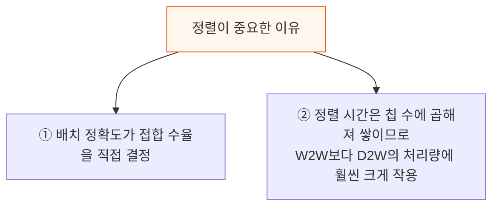

이 두 장벽 때문에 하이브리드 본딩은 사실상 전공정에 가까운 공정이 된다. ASML은 리소그래피에서 이 두 문제를 풀어 온 경험이 있다.

### 정렬: 웨이퍼 정렬 센서의 재활용

특허에 따르면 접합 시스템은 칩마다 작은 회절 격자를 놓고, 격자가 산란시킨 빛으로 칩의 위치를 읽는다. 원리는 2017년 이후 모든 신형 TWINSCAN에 들어간 웨이퍼 정렬 센서 ORION과 같다.

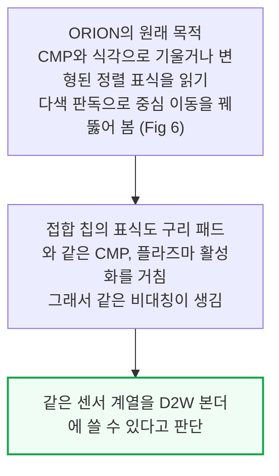

### 정렬 오차 여유: 스캐너 정밀도

센싱과 구동 능력은 전체 정렬 오차 예산에서도 여유를 준다.

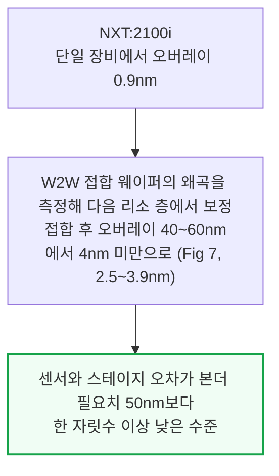

이 수치는 리소그래피 숫자이지 접합 결과가 아니다. 다만 스테이지 정밀도가 높으면 본더 오차 예산에서 다른 요인, 곧 홀더 위 칩 이동, 열 드리프트, 접촉 중 움직임에 쓸 여유가 늘어난다.

### 구동: Prodrive와 VDL ETG

두 업체는 ASML 본더의 구동 부품 공급사로 지목된다(The Elec 보도).

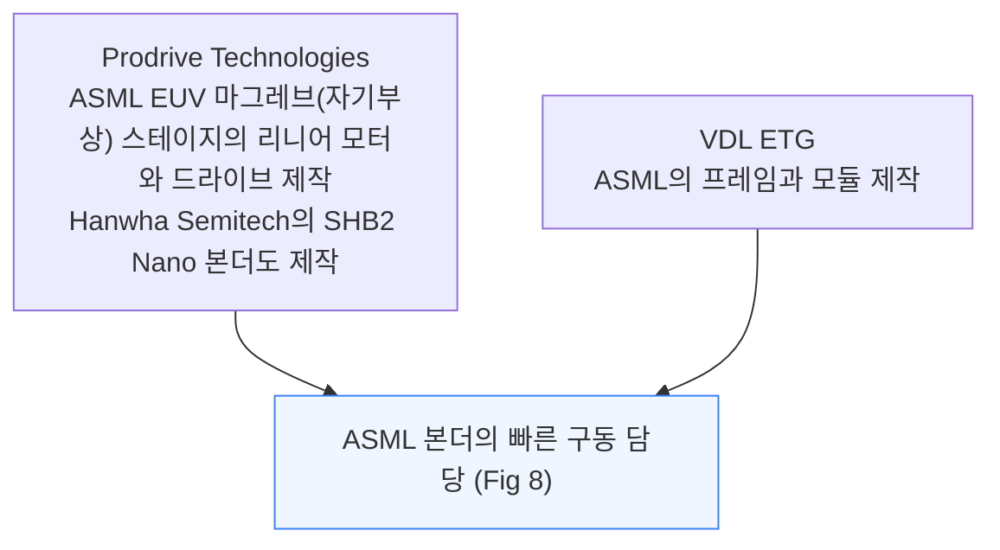

### 청정도: EUV 경험

ASML EUV 시스템의 청정도 요구는 본더보다 엄격하다. 나노미터 규모의 입자와 오래 싸운 장비사는 드물다. EUV 스캐너는 레티클과 웨이퍼를 진공에서 움직이며, 레티클 입자 추가량을 "10nm 미만 노드 리소그래피의 양산 요건에 맞는" 수준으로 유지한다.

ASML은 접합면도 고려한 것으로 보인다. 접합 장치 특허(WO2026098870A1)는 기판 지지대를 세정하는 도구와, 지지대의 평탄도·입자 부하·왜곡을 감시하는 센서를 더했다.

다만 본더 안의 오염물은 스캐너와 다르다. 대부분은 칩 가장자리의 다이싱 부스러기와, 방금 활성화되어 물을 좋아하는(친수성) 표면에 내려앉는 입자다. ASML이 이런 본더 고유 오염물을 어떻게 다루는지는 이후 특허에서 더 확인하겠다고 원문은 밝혔다.

<a id="s5"></a>

## 5. ASML이 풀어야 할 네 가지 과제

**📌 핵심:**
- 작동하는 고수율 장비까지 풀 과제는 넷: 앞의 둘은 ASML이 직접 풀 공학 문제, 뒤의 둘은 협력사와 풀 공급망 문제
- 접합 단계에서는 실리콘이 센서에 불투명해 칩 너머를 볼 수 없어, 앞에서 잰 위치를 믿어야 함
- 시중에는 칩 한 개를 몇 초 만에 트랙 옆에서 처리하는 모듈이 없고, 트랙 기본 청정도(ISO 6)는 접합 요구(ISO 3)보다 세 등급 낮음
- 결론: 양산은 2030년 이전은 어렵다. ASML 매출 반영 시점은 "2030년 훨씬 이후"

### 과제 1. 피드포워드 계측

ASML은 한 장치에서 칩을 홀더 기준으로 재고, 접합 장치에서 그 기준을 믿는다. 접합 장치에서는 칩 너머를 볼 수 없다.

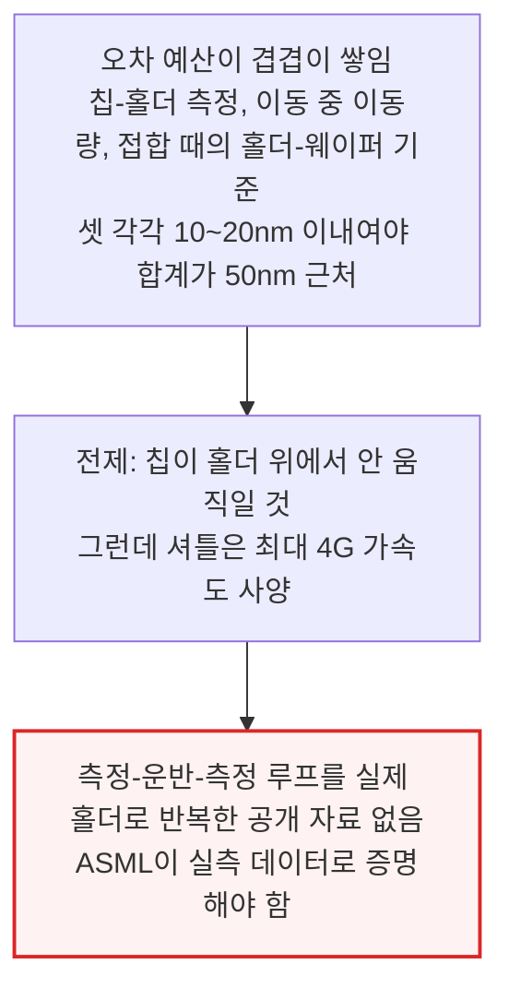

### 과제 2. 접촉(contact)

칩을 잡고, 놓고, 본드 웨이브를 조종하는 일은 여러 해의 공정 노하우가 필요한데, ASML은 이 분야에 새로 들어온다. 기존 접합은 이렇게 이루어진다.

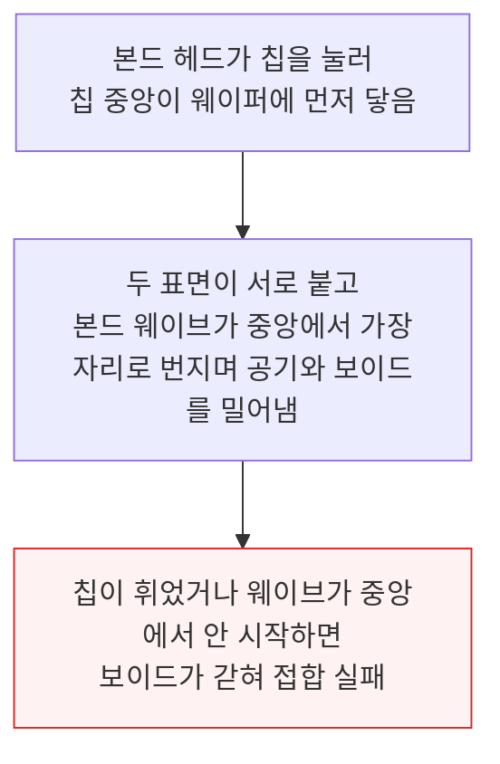

ASML의 특허는 자기 방식을 설명한다(Fig 9). 홀더는 자체 척과 미세 액추에이터를 갖춘 작은 셔틀로, 바퀴(B), 공기·진공 베어링(C), 자기부상(D) 중 하나로 트랙을 달릴 수 있다.

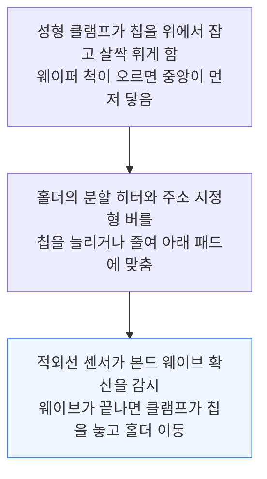

이론적으로는 가능하지만 실제로 시연된 것은 없다. 대화한 업계 전문가도 이 설계의 휨 제어에 의문을 표했다. 실현 가능성을 판단하려면 ASML의 추가 증거가 필요하다.

### 과제 3. 다른 장비의 개조: 공급망 협업

ASML의 트랙에는 칩이 멈춘 자리에서 일하는 장치가 필요하다. 오늘 시장의 장비는 챔버형이다. 웨이퍼나 프레임에 붙은 잘린 웨이퍼를 챔버 안으로 옮겨 놓고 그 안에서 작업한다.

칩 하나를 몇 초 만에 세정, 활성화, 측정하는 트랙 옆 모듈은 아무도 팔지 않는다. 다만 AMAT, EVG, Lam 같은 기존 업체는 기존 장비를 개조할 만한 공정 노하우를 가졌다고 본다. ASML이 이들과 장치 모듈을 함께 만들어야 하고, 이는 다시 서브시스템·부품 공급사의 지원이 필요하다.

### 과제 4. 루프 전체의 청정도와 비용

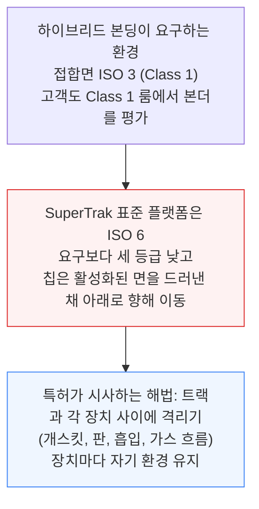

장치 사이 입자 관리와 이 청정 미니 환경의 유지 비용은 장비의 수율과 가격 대비 성능을 크게 좌우할 수 있다.

### 출시 시점

정보가 거의 없어 날짜를 못 박기 어렵다. 경영진은 매출 시점을 "2030년 훨씬 이후"로 말했고, SemiAnalysis의 채널 점검에서는 대만 파운드리나 OSAT 어디에서도 ASML 본더가 확인되지 않았다.

그래서 양산은 2030년 이전에는 어렵다고 본다. 이는 ASML이 첫 D2W 물결에서 빠진다는 뜻이지만, 그 물결도 2029년 이후로 밀릴 것으로 본다. 그래도 ASML의 진입은 이미 HBM 디스펙으로 시장 규모가 깎인 Besi에 의미 있는 압박이 된다.

<a id="s6"></a>

## 6. Besi에 더해지는 압박

**📌 핵심:**
- D2W 하이브리드 본딩 시장은 2024년 초 SemiAnalysis의 분석 이후 크게 바뀜. Besi는 여전히 선두이지만 성장 전망이 로직과 HBM 양쪽에서 덜 매력적
- Besi 하이브리드 본딩 고객의 절반이 로직이고 설치 장비의 약 70%가 로직용(SemiAnalysis 추정), 고객은 인텔과 TSMC에 집중
- HBM은 한국 업체의 추격과 디스펙(4-hi, 8-hi)으로 흔들림. 2028년 컨센서스 매출의 최대 20%가 HBM 하이브리드 본딩
- 결론: ASML 장비는 2030년 이후라 2026\~29년 로직 수주에 미칠 영향은 작지만, 장기 전망은 약해짐

### 로직: 두 고객에 집중

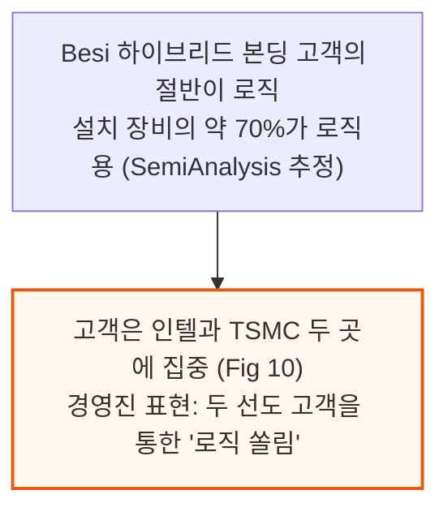

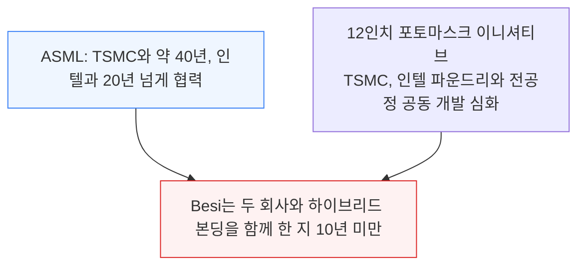

후공정에서도 비슷한 일이 벌어져도 놀랍지 않다. 다만 ASML의 D2W 장비는 2030년 이후에야 시장에 나올 것으로 보여, Besi의 2026\~29년 로직 수주 잔고에 미치는 영향은 제한적일 것이다.

### HBM: 한국 업체의 추격

HBM은 Besi가 다음 성장 시장으로 건 곳이다. 그런데 한국 업체가 따라붙고 있다.

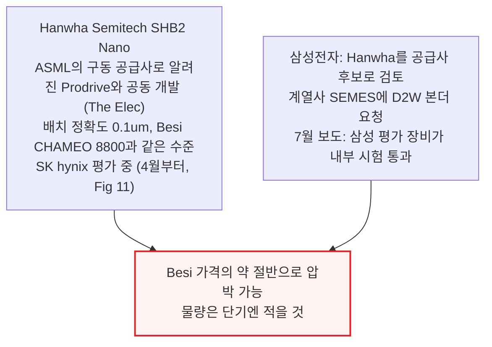

### HBM 디스펙으로 이미 약해진 전망

SemiAnalysis가 8월에 짚은 4-hi, 8-hi 디스펙은 하이브리드 본딩이 풀려던 높이 문제를 없앴다.

```mermaid
flowchart TD
    A["SK hynix: 하이브리드 본딩을 HBM5로 연기<br/>삼성: HBM4E에서 부분 상용화 언급<br/>Micron: 대신 액체 냉각 검토"] --> B["Besi 경영진도 7월에 HBM 도입이<br/>2027년 일정 이후로 밀릴 수 있다고 인정"]
    B --> C["HBM 하이브리드 본딩은 2028년 컨센서스 매출의 최대 20%로 추정<br/>지연은 성장 전망에 큰 부담"]
    style C fill:#fef2f2,stroke:#dc2626,stroke-width:2px
```

### Besi의 남은 방어선

Besi에는 선발 주자 이점과 AMAT 같은 협력사가 있다. NHanced 같은 패키징 업체도 Besi CHAMEO 장비로 D2W 하이브리드 본딩을 서비스로 판다. 이런 결합은 경쟁사의 진입 문턱을 높인다. 고객이 장비 하나가 아니라 공정 전체를 다시 인증해야 하기 때문이다.

---

*작성 진행률: 약 100% 완료*
*업데이트: 1\~6절 전체 작성 완료*
