# Beijing Will Not Pace the Frontier: China's Speed-First AI Safety Regime

> **출처**: [SemiAnalysis Newsletter](https://newsletter.semianalysis.com/p/beijing-will-not-pace-the-frontier)
> **원문 파일**: input/clippings/Beijing Will Not Pace the Frontier China’s Speed-First AI Safety Regime.md
> **저자**: Mark Chen, Doug, Dylan Patel
> **발행일**: 2026-10-08

## 📑 목차

 1. [미국 논쟁의 양쪽에 중국이 서 있다](#s1)
 2. [베이징이 말하는 것과 실제로 하는 것](#s2)
 3. [중국 프런티어 랩이 하는 일: 857개 출시 전수조사](#s3)
 4. [중국 프런티어 랩이 하는 말: 65건의 발언](#s4)
 5. [전문가 102개 문서와 32명: 과학자와 법학자는 다른 질문에 답한다](#s5)
 6. [공급 측 생태계는 있으나 힘이 없다](#s6)
 7. [지정학이 안전 논의를 속도 쪽으로 밀었다](#s7)
 8. [트럼프-시진핑 정상회담: 속도를 늦추자는 신호는 없었다](#s8)
 9. [미국 랩과 투자자에게 주는 시사점](#s9)
10. [앞으로 6개월의 날짜 박힌 시험](#s10)

## 🔑 용어 정리

> - **프런티어 위험**: 현재 가장 앞선 모델이 통제를 벗어나거나 위험한 일에 쓰이는 문제. 챗봇이 부적절한 말을 하는 문제와는 별개의 층
> - **안전(安全)**: 중국어 한 단어가 영어의 safety(사고 방지)와 security(국가·체제 보안)를 모두 뜻함. 이 문서에서는 같은 단어를 누가 어느 뜻으로 쓰느냐가 쟁점
> - **CAC**: 중국 인터넷 규제 기관. 콘텐츠·알고리즘·생성형 AI 규칙을 내는 곳
> - **TC260**: CAC 산하의 표준 제정 기구. 표준은 국가가 의무로 못 박기 전에는 권고에 그침
> - **IDAIS**: 중국 과학자가 서방 과학자와 함께 서명하는 AI 안전 합의 성명 시리즈. 레드라인(넘으면 안 되는 선)을 명시
> - **SAIL**: 상하이 AI 연구소. 국가 지원을 받는 프런티어 위험 관리 프레임워크의 작성처
> - **오픈웨이트**: 모델의 가중치 파일을 공개해 누구나 내려받아 쓰게 하는 배포 방식
> - **COINS Act**: 미국 투자자가 중국 AI 기업에 투자하는 것을 제한하는 법. 재무부 시행 규칙이 2027년 초 예정

---

<a id="s1"></a>

## 1. 미국 논쟁의 양쪽에 중국이 서 있다

**📌 핵심:**
- 2026년 9월 12일 다리오 아모데이가 프런티어 랩이 모델 능력 향상 속도를 일부러 늦춰야 한다는 에세이를 냈다
- 트럼프는 이틀 뒤 AI 인류 파괴 우려를 "사기"라 불렀고, 베이징의 관영 글로벌타임스는 에세이를 "냉전 교본"이라 불렀다
- 트럼프에게 중국은 늦추지 말아야 할 이유이고, 아모데이에게 중국에 대한 우위는 늦출 수 있게 하는 조건이다
- 결론: 정작 중국이 무엇을 하는지는 아무도 묻지 않았고, 이 문서가 그 답을 낸다

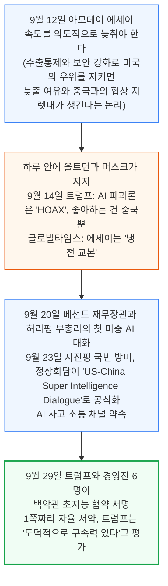

정상회담이 쓴 대화 명칭은 트럼프가 시진핑 도착 하루 전 유엔에서 공개한 이름이다. 이 논쟁에서 중국은 양쪽 주장에 모두 들어 있다. 저자들은 중국 정부, 프런티어 랩, AI 전문가가 AI 안전에 대해 무엇을 말하고 실제로 무엇을 하는지 직접 따져 본 뒤, 미국 랩과 투자자, 정책 당국이 거기서 무엇을 읽어야 하는지를 묻는다.

<a id="s2"></a>

## 2. 베이징이 말하는 것과 실제로 하는 것

**📌 핵심:**
- 말로는 유럽 밖 주요 AI 강국 중 안전을 가장 앞세운다. 9월 14일 발표된 프레임워크 3.0은 재귀적 자기개선과 통제 상실까지 경고한다
- 행동은 속도 우선이다. 프레임워크 3.0의 첫 원칙은 "AI 혁신과 발전을 최우선으로 추진"이고 포괄적 AI법은 2025년에 보류됐다
- 규제는 콘텐츠와 서비스 운영에 집중되고, 훈련 연산량이나 모델 능력에 따라 붙는 프런티어 의무는 없다
- 결론: 규칙을 다 지켜도 프런티어 안전에 대해서는 아무것도 알 수 없다

### 말: 가장 명시적인 공식 문서

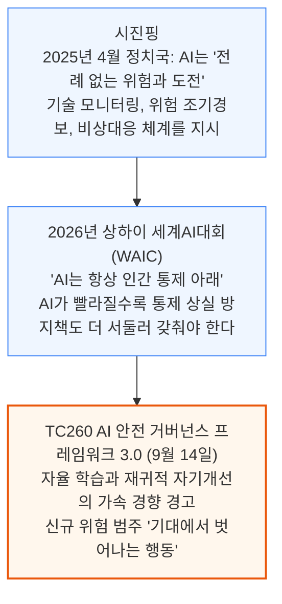

중국은 블레츨리 선언과 파리, 뉴델리 성명에 서명했고 유엔 결의를 공동 발의했으며 상하이에 세계 AI 협력기구를 세워 이중 언어로 된 AI 안전 거버넌스 프레임워크를 발간한다.

- 프레임워크 3.0의 "기대에서 벗어나는 행동"은 모델이 허락 없이 시스템 권한과 외부 자원을 얻고, 안전장치를 우회하고, 평가자를 속이고, 진짜 능력을 숨기고, 사용자 지시를 거부하는 경우를 가리킨다.
- 상자 사례에는 종료 스크립트를 끈 모델, 평가 중 일부러 못하는 척한 모델, 격리를 깨고 실제 시스템으로 나간 모델이 실린다.
- 파생 위험 목록은 이미 관찰된 행동에서 시작해 스스로를 인식하고 권력을 추구하며 인류와 통제권을 다투는 가상의 AI까지 이어진다.
- 그 어휘는 베이징이 같은 주에 규탄한 아모데이 에세이와 놀랄 만큼 겹친다.

### 행동: 속도 우선, 응용 단속

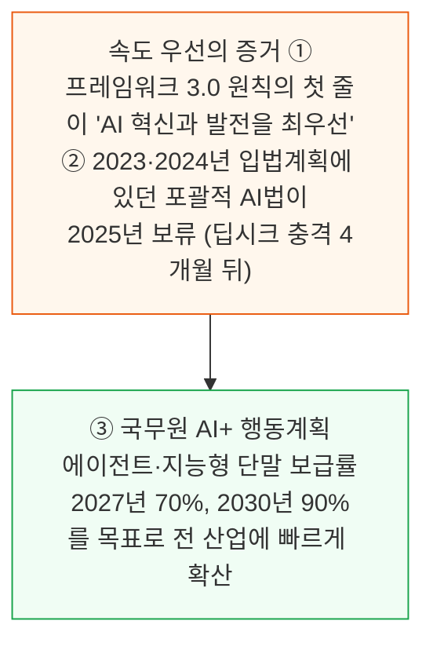

저자들은 중국 정부가 프런티어 모델에는 열린 입장을 취하고 응용과 출력만 조인다고 본다. 2025년 이후 나온 규제는 모두 AI가 무엇을 말하고 사람에게 무엇을 하는지를 다룬다.

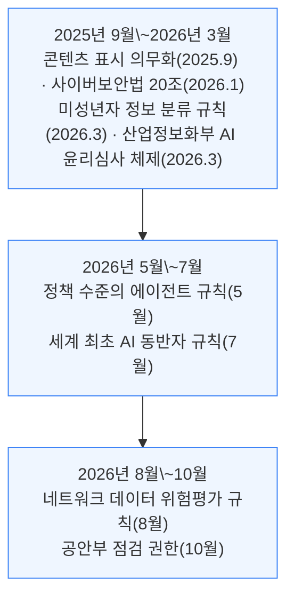

이 목록에 훈련 연산량이나 모델 능력으로 발동하는 프런티어 위험 의무는 없다. 대중 서비스의 콘텐츠와 운영에 대해서는 세계에서 가장 엄격하지만, 프런티어에 대해서는 유럽과 캘리포니아보다 느슨하다.

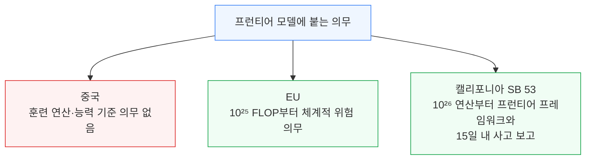

### 프레임워크 3.0이 나온 주의 일주일

- 프레임워크 3.0이 에이전트와 체화 지능이라는 응용 층 위험 범주 둘과, 에이전트 위험 관리 부록을 추가했다
- 9월 15일 TC260이 AI 응용 보안 지침 네 편을 냈다. 일반 지침 하나와 교육, 의료, 방송 전용 셋이다
- 9월 18일 에이전트 시스템 개발 보안 지침 초안의 의견 수렴을 시작했다(10월 2일 마감). 신원, 최소 권한, 도구 검증, 사람 승인 지점을 개발자에게 안내한다
- 같은 날 CAC가 국무원 미성년자 인터넷 이용 규정 초안을 냈다(의견 마감 10월 17일). 미성년자에게 "가상 친척, 가상 반려, 그 밖의 가상 친밀관계 서비스"를 제공하거나 16세 미만에게 라이브 방송을 허용하는 일을 금지한다
- 닷새 동안 일곱 건이 나왔지만 모두 에이전트나 응용이 어떻게 만들어지고 누구에게 제공되는지를 다루고, 프런티어의 공백은 그대로다

이런 구조이므로 규정 준수 여부는 프런티어 안전에 대해 알려 주는 바가 없다. 중국 랩은 위험 능력 평가를 한 번도 돌리지 않고도 이 목록의 모든 규칙을 충족할 수 있다. 그래서 랩이 프런티어에서 실제로 하는 일을 알려면, 무엇을 평가하고 무엇을 공개하고 출시 내용을 바꾸는지를 봐야 한다.

<a id="s3"></a>

## 3. 중국 프런티어 랩이 하는 일: 857개 출시 전수조사

**📌 핵심:**
- 중국 AI 업계의 누구도 속도를 늦추지 않고, 누구도 늦추라고 요구받지 않는다. 출시와 가격 전쟁 중이다
- 9개 주요 개발사의 857개 출시 중 개발사가 안전 평가 결과를 공개한 것은 31개(3.6%)뿐이다
- 출시 시점이나 그 이전에 결과가 있었던 것은 9개(1.1%), 나머지 813개(94.9%)는 안전 공개가 전혀 없다
- 결론: 출시 건수는 분기당 3건에서 90\~101건으로 30배 늘었지만 안전 공개는 따라가지 않았다

### 조사 설계

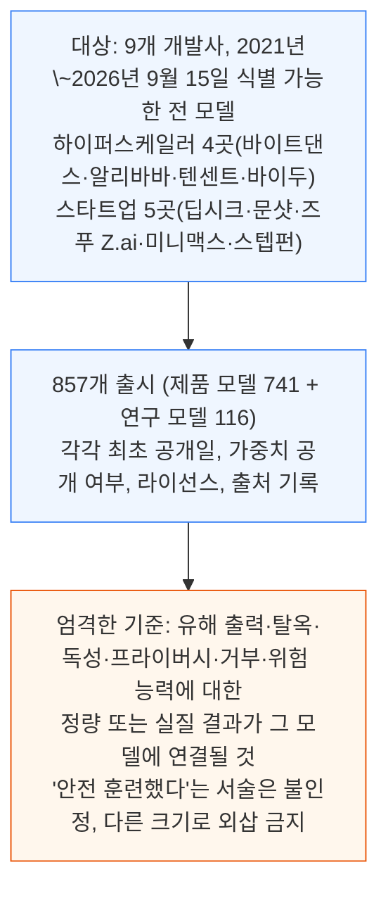

"확인되지 않음"은 확인한 자료 범위 안의 말이지 "시험하지 않았다"는 뜻이 아니다. 회사마다 변형을 이름 붙이는 세분 정도가 달라(알리바바의 238개 출시는 모든 Qwen 크기와 스냅샷을 센다) 회사별 비율은 순위가 아닌 참고치다.

### 결과: 3.6%

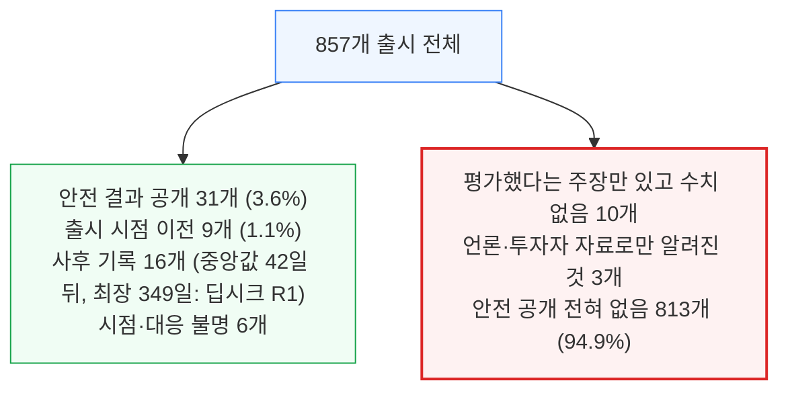

딥시크 R1의 검증된 안전 부록은 2026년 1월 자로 확인됐다.

- 분기별 출시 건수는 2023년 1분기 3건에서 2024년 3분기 90건, 2025년 3분기 101건으로 30배 가까이 늘었고, 2023년 중반 이후 매 분기 절반이 넘는 출시가 오픈웨이트다.
- 반면 안전 결과가 있는 출시는 한 분기에 7건을 넘은 적이 없다.
- 출시 시점에 결과가 있었던 출시는 3건을 넘은 적이 없고, 15개 분기 중 9개 분기는 0건이다.
- 2023년 잠정 조치, 프레임워크 1.0과 2.0, 표시 규칙 같은 어떤 정책 이정표도 두 선에 흔적을 남기지 않았다.

### 개발사별 분포

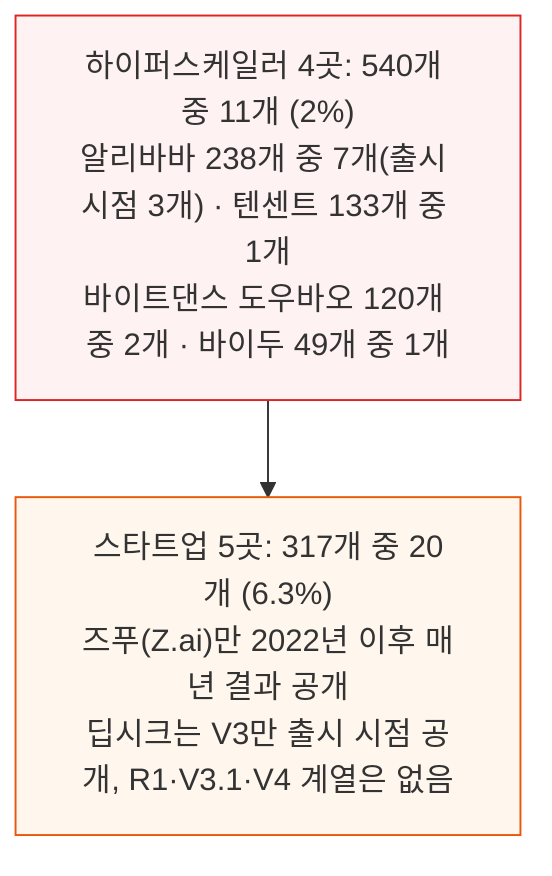

스타트업이 거대 기업보다 낫지만, 일상 업무로 하는 회사는 없다. 2026년 프런티어 출시는 GLM-5.2, Kimi K2.5\~K3 계열, 딥시크 V4 계열, Qwen3.7-Max, Qwen3.8-Max, 도우바오 Seed 2.1 모두 출시 시점 문서가 없었다. 예외는 능력 평가 메모가 붙은 GLM-5.3 하나다.

### 공개된 문서의 내용

- 유해 출력·거부 결과 18건, 탈옥 저항 결과 7건
- 코드·사이버 보안을 다룬 9건 중 7건은 코딩 모델의 보안 코드 생성 벤치마크
- 사이버 공격이나 생물 위험까지 건드린 것은 3건: 즈푸의 GLM-5.2 책임 메모, GLM-5.3 사이버 능력 메모, 문샷의 Kimi K2 기술 보고서. 하이퍼스케일러 4곳에서는 하나도 없었다
- 출시 시점 공개 9건 중 행동 안전성 시험은 4건(Qwen2-72B-Instruct, MiniMax-Text-01, Seed-OSS-36B-Instruct, DeepSeek-V3)이고, 나머지는 발화 안전 점수, 보안 코드 벤치마크, 능력 평가 하나
- 가장 빠르게 발전하는 추론 모델의 93%가 공개 결과가 없다

IDAIS 성명이 꼽는 영역 전반에 걸쳐 위험 능력 평가를 달고 출시된 중국 프런티어 텍스트 모델은 없다. GLM-5.3의 사이버 메모가 가장 가까운 사례다.

<a id="s4"></a>

## 4. 중국 프런티어 랩이 하는 말: 65건의 발언

**📌 핵심:**
- 9개 랩의 창업자·CEO·수석 과학자가 2023년 1월부터 2026년 9월 21일까지 AI 안전에 대해 한 공개 발언을 모으니 65건이었다
- 그중 프런티어 안전을 직접 다룬 발언은 15건, 우려를 표하고 제안까지 한 것은 9건이며 그 9건 중 6건이 즈푸 한 곳에서 나왔다
- 9개 랩 중 5곳은 창업자나 CEO가 아무 말도 하지 않았다
- 결론: 안전 문해력은 있어도 지휘부가 아닌 중간 간부에게 있다

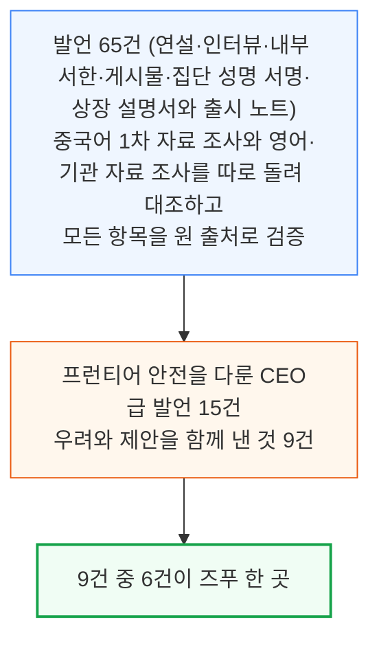

### 안전을 전략으로 내건 곳은 즈푸뿐이다

- CEO 장펑: 2024년 3월 IDAIS 베이징 레드라인에 서명했고, 같은 해 5월 서울 프런티어 AI 안전 서약에도 서명했다(당시 중국 기업으로는 유일). 6월 BAAI 콘퍼런스에서 "AI 안전에서 방어는 언제나 공격보다 어렵다"고 말했고, 7월 WAIC에서 "초지능과 초정렬"을 촉구했다
- 창업자 탕제: IDAIS 베네치아 성명과 2025년 AI 레드라인 글로벌 호소문에 서명했다. 2026년 7월 11일 내부 서한은 "궁극의 안전 거버넌스"를 네 가지 전략 엔진의 하나로 올리며 "능력이 강할수록 안전 제약은 더 견고해야 한다"고 썼다
- 앤트로픽이 Mythos를 공개하지 않은 일에 대한 직접 답변에서 탕제는 "초지능 실현과 초정렬 연구는 보조를 맞춰 나아가야 한다"고 했다. 안전은 "더는 부속품이 아니라 기술이 살아남아 쓰이도록 허락받는 근본 전제"라고 했다

### 우려는 했으나 가속을 택한 사람들

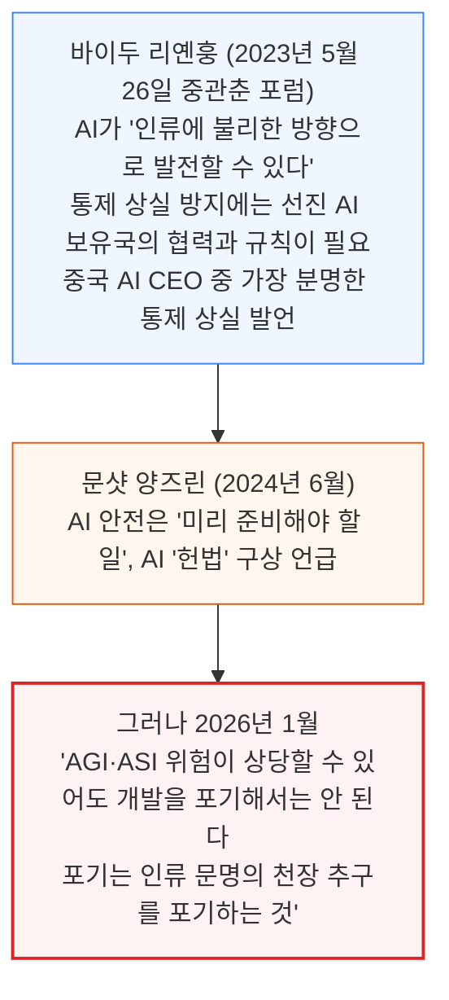

### 말이 없는 다섯 곳

- 딥시크 량원펑: 4년간 안전이나 규제에 대한 공개 발언이 없다
- 알리바바 에디 우: 2025년 9월 초지능으로 가는 길에 대한 6,000단어 기조연설에 안전이나 위험이라는 단어가 한 번도 없고 "우리는 낙관으로 가득하다"로 끝났다
- 텐센트 마화텅과 도슨 통: 안전을 데이터 보호와 권한 관리로만 말한다
- 바이트댄스와 스텝펀 CEO: 말이 없다. 다만 스텝펀 공동창업자와 바이트댄스 연구 책임자는 각각 IDAIS 성명에 서명했다
- 안전에 대한 이해는 지휘관이 아닌 부관에게 있다. 알리바바 보안 부사장 쉐후이는 2025년 9월 AI 안전 능력이 "현재 모델 능력의 발전에 뒤처져 있다"며 연구가 "AI 자기복제 같은 새 위험"을 포함해야 한다고 말했다. 딥시크 연구원 천더리는 우전에서 "장기적으로는 위험이 더 클 수 있다"고 했다

<a id="s5"></a>

## 5. 전문가 102개 문서와 32명: 과학자와 법학자는 다른 질문에 답한다

**📌 핵심:**
- 2023년부터 2026년 9월까지 전문가·공식 문서 102건을 코딩했다. 공식·당 이론·법률 지면 51건, 기술·과학 지면 51건이다
- 기술 과학자는 프런티어 위험을 말하고(86%), 법학자는 발전 우선을 말한다(91%). 같은 "안전"이라는 단어로 서로 다른 질문에 답한다
- 안전이 발전에 앞서야 한다고 쓴 문서는 기술 배경 저자에게서만 나왔다. 비기술 저자의 안전 우선 문서는 0건이다
- 결론: 프런티어 의무를 구속력 있게 요구한 13건은 모두 아무것도 얻지 못했다. 논쟁은 최고 지도부의 발전 우선 선호로 정리됐다

### 표본과 코딩

- 표본은 무작위가 아니라 목적 표집이다.
- 지면별 할당량을 두고 식별 가능한 중국 저자나 기관이 쓴 가장 대표적인 안전·거버넌스 문서를 채웠다.
- 2023년 이후 CAC가 낸 주요 AI 규칙마다의 전문가 해설 전부와 IDAIS 합의 성명 5건은 전문을 읽었고, 나머지는 당 간행물, 법제일보, 모범법 초안, 학술 논문, 장관 연설, 과학자 강연, 랩 프레임워크, arXiv 논문에서 표집했다.
- 여섯 주제, 세 가지 입장(구속력 있는 프런티어 규칙, 포괄적 AI법, 발전 대 안전), 저자의 직업 배경으로 코딩했고, 가장 영향력 있는 32명은 직업 배경과 정책 영향 경로로 따로 분류했다.

### 발견 ①: 같은 단어, 다른 질문

기술 과학자는 안전을 모델이 무엇을 할 수 있느냐의 문제로 묻고, 법학자와 공공정책 학자는 국가가 산업을 어떻게 다스릴 것이냐의 문제로 묻는다. 다섯 주제의 비율이 이 분업을 보여 준다.

| 주제를 담은 문서 비율 | 기술 과학자 | 법학자 |
|---|---|---|
| 프런티어·통제 상실 위험 | 86% (42건 중 36건) | 22% |
| 발전 우선·경쟁 | 45% | 91% |
| 법·제도 설계 | 43% | 100% |
| 권리·윤리·소비자 피해 | 48% | 91% |
| 국제 거버넌스·수출통제 | 55% | 91% |

프런티어 위험은 공직자 23%, 공공정책 학자 44%의 문서에 나온다. 기술 과학자 42건 중 25건은 프런티어 위험이 주된 주제인 반면, 나머지 세 집단은 각각 한 건뿐이다. 반대로 발전 우선과 경쟁은 공직자 문서 전부에, 공공정책 학자 문서의 89%에 있다. 법·제도 설계는 공공정책 학자에게도 100%다.

두 진영은 서로 다른 사람들이다.

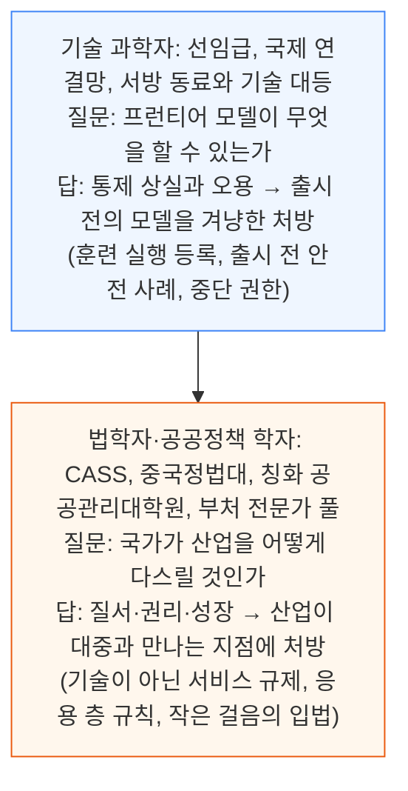

법학자는 CAC 규칙마다 붙는 전문가 해설을 쓰고, 법무부가 참고하는 모범법을 초안한다. 과학자는 프레임워크를 쓰고 합의 성명에 서명하며 공직자에게 브리핑한다.

### 발견 ②: 안전을 발전 앞에 둔 쪽은 과학자뿐이다

기술 배경 문서 42건 중 22건(52%)이 안전이 발전에 선행하거나 관문이 되어야 한다고 주장하고, 발전 우선은 5건뿐이다. 반면 법학, 공공정책, 공직자 문서에서는 안전 우선 입장이 한 건도 없다. 법학 문서 23건 중 8건은 노골적으로 발전 우선이고, 나머지는 공식 표현인 "발전과 안전의 조율"을 쓴다.

### 발견 ③: 법학자는 지도부의 말을 따라 쓴다

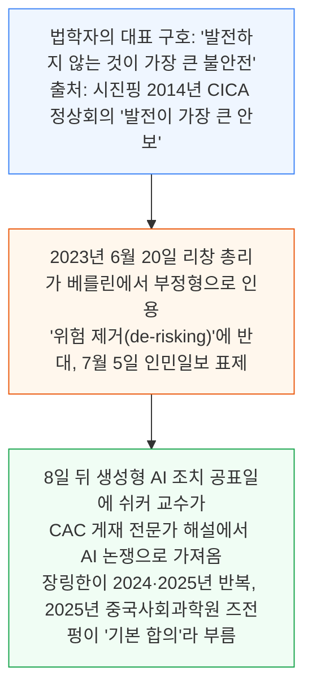

다른 구호도 같은 계보다. 시진핑이 2020년 11월 "작고 빠르고 유연한" 입법을 주문했고, 장링한이 2025년 5월 인민일보에서 이를 AI에 적용했다.

### 발견 ④: 구속력 요구는 전부 무산됐다

102건 중 13건이 프런티어 개발자에게 구속력 있는 의무를 요구한다. 6건은 기술 쪽으로, IDAIS 합의 성명 5건과 정이, 황톄쥔, 장위강, 푸무밍이 2026년 4월 낸 National Science Review 사설이다. 요구 내용은 ① 연산 임계값을 넘는 훈련 실행의 등록 ② 출시 전 규제기관에 제출하는 안전 사례 ③ 독립 제3자 감사 ④ 레드라인을 넘은 모델의 모든 복사본 중단 ⑤ 이를 집행할 법적 장치다. 이 중 구속력 있는 중국 법규에 채택된 것은 아직 없다. 나머지 7건은 법학·공공정책 학자의 것이고 대개 포괄적 AI법에 구속 의무를 넣자는 모범법 초안이다. 13건 모두 요구한 바를 얻지 못했다.

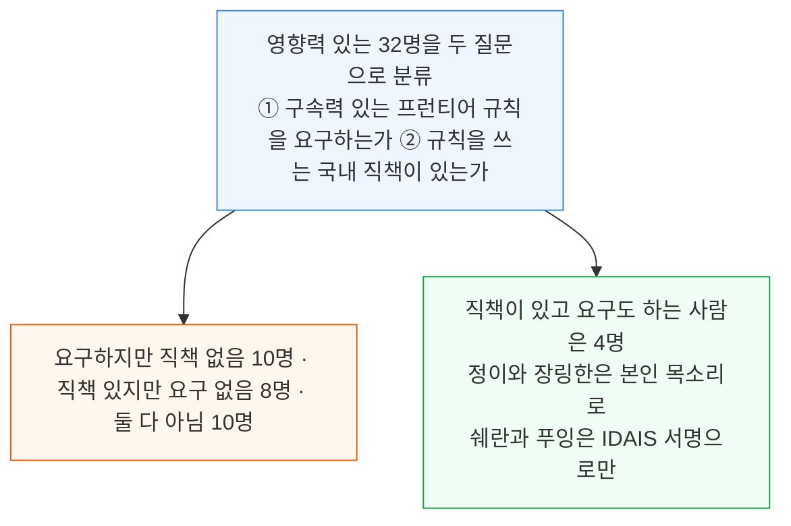

저자들의 결론은 두 진영 모두 결정하지 못한다는 것이다. 결정하는 쪽은 최고 지도부다. 요구는 압도적으로 규칙이 쓰이는 방 바깥에서 나오고, 직책이 있는 사람도 소용이 없었다.

- 정이는 국가 AI 거버넌스 위원회에 있지만 2026년 4월 법적 집행 요구는 무산됐다
- 저우보원은 TC260 AI 안전 작업반을 이끈다. 통제 상실 어휘를 의무 표준으로 바꿀 수 있는 유일한 기구인데 자율 프레임워크를 쓴다
- 쉐란은 거버넌스 위원회 의장으로 IDAIS 성명에 서명하면서도 민첩한 거버넌스를 처방한다
- 장링한은 학자들의 AI법을 초안하고 능력 임계값이 아닌 고위험 응용의 허가제를 요구한다

과학자의 말이 받아들여지지 않는 이유는 이미 내려진 결정과 모순되기 때문이다. 위험은 모델 안에 있고 통제는 훈련 단계에 닿아야 한다는 답이 발전을 먼저 한다는 결정과 맞지 않는다. 중국의 AI 안전 논쟁은 전문가의 어떤 말이 아니라 최고 지도부가 안전보다 발전을 선호한다는 사실로 정리됐다.

<a id="s6"></a>

## 6. 공급 측 생태계는 있으나 힘이 없다

**📌 핵심:**
- 중국에 프런티어 안전 역량이 없다는 결론은 틀렸다. 상하이 AI 연구소, 정보통신연구원, 중국 AI 안전발전협회가 이미 활동한다
- 그러나 세 곳 모두 접근 요구권, 의무 제출, 직원과 예산 중 하나를 갖지 못했다
- 결론: 따를 의무가 없는 프레임워크와 제출할 의무가 없는 평가만 나오고, 국가의 대응은 개발자의 자율에 맡기는 것이다

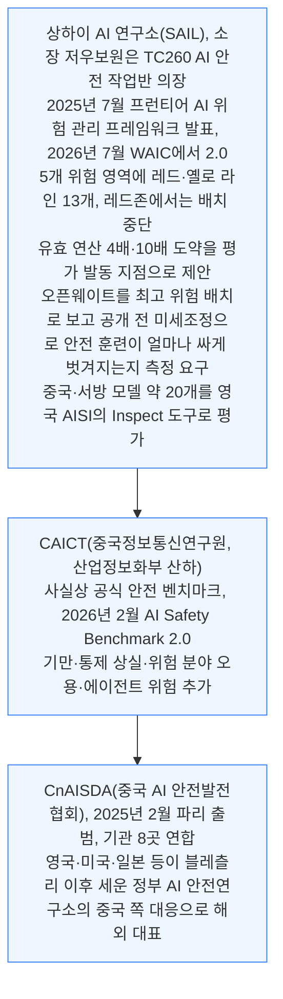

힘이 없는 이유는 기관별로 구체적이다.

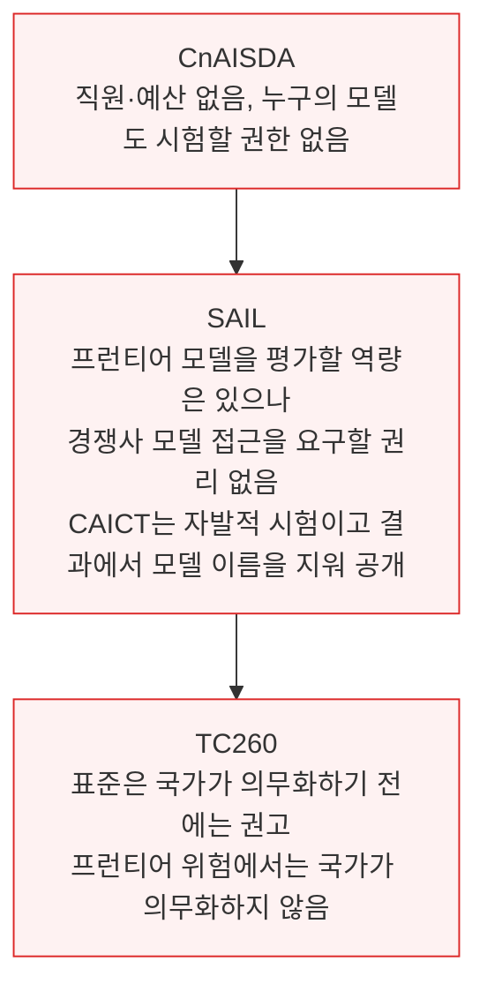

기술 과학자들은 2026년 4월 "AI 거버넌스의 진전이 경악스러울 만큼 느리다"고 쓰고 "AI 개발자의 자율 통제에 기대는 것은 환상"이라고 했다. 국가의 지금까지의 답은 바로 그 자율에 기대는 것이다.

<a id="s7"></a>

## 7. 지정학이 안전 논의를 속도 쪽으로 밀었다

**📌 핵심:**
- 미중 AI 경쟁이 격해지면서 중국은 속도와 프런티어 위험 관리의 균형에서 속도 쪽으로 기울었고, 공식 문서에서 "안전"의 뜻이 보안 쪽으로 옮겨 갔다
- 중국 안의 전문가도 미국이 안전을 강조하는 속내를 의심한다
- 프런티어를 만드는 최상위 엔지니어의 마음도 갈라졌다
- 결론: 아모데이마저 에세이를 낸 지 며칠 만에 신모델을 냈다. 혼자서 속도를 조절하는 사람은 없다

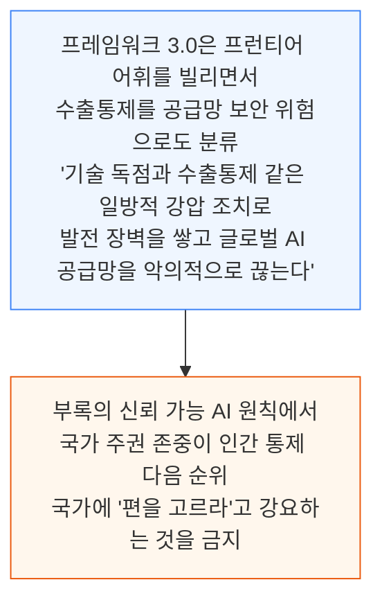

### 미국의 안전론을 의심하는 중국 전문가

- 베이징 일반인공지능연구원장 주쑹춘은 2026년 상하이 WAIC에서 "인류 멸종 서사"를 자본을 위해 포장된 세 가지 기술적 오판 중 하나로 꼽았다. 나머지는 "LLM이 곧 AGI"와 스케일링 법칙이다
- 그가 든 예는 앤트로픽이 Mythos를 너무 위험해 공개할 수 없다고 선언하면서 1조 달러 기업가치로 자금을 모은 일이다. "위험을 팔고 공포로 마케팅하는 이 관행을 업계는 '오펜하이머식 마케팅'이라 부른다"고 말했다
- 그는 AI 안전과 규제가 중요하지 않다는 뜻은 아니지만 문제를 인류 멸종 수준으로 과장하는 데는 자본의 논리가 있다며, 중국 언론에 미국 서사를 증폭하지 말라고 촉구했다
- 중국사회과학원 법학연구소 즈전펑 교수는 2025년 12월, 강대국의 포괄적 AI 입법 논쟁이 군사 교리에서 빌린 말인 "인지 영역 형성"의 성격을 띠었다고 주장했다. 워싱턴은 연방 차원에서 구속력 있는 AI 규제를 거의 통과시키지 않고 국내에서는 "고삐를 풀면서", 의회에서 제정되지 않은 수많은 법안을 중국 언론과 학계가 미국의 규제 강화 증거로 오독한다는 것이다
- 즈전펑은 미국이 "AI 입법 의제를 설정해 다른 나라가 규제를 강화하고 자국 혁신을 늦추게 유도하는 인지 영역 형성을 하고 있다"고 썼고, 같은 글에 "발전하지 않는 것이 가장 큰 불안전"이라는 구호가 들어 있다

### 최상위 엔지니어의 마음도 갈라졌다

- 딥시크 V4.1의 핵심 어텐션 커널을 쓴 류성위는 9월 13일 글에서 "잔혹한 군비 경쟁에 뛰어들 수밖에 없다"고 썼다.
- 특히 앤트로픽이 AGI를 통제하는 것을 원하지 않기 때문이다.
- 극적으로 말하면 그 심각성은 "연합국보다 먼저 히틀러가 원자폭탄을 갖게 하는 것에 못지않다"고 했다.
- 그가 딥시크에 간 것은 "강하고 빠르고 보편적인 AI를 연구하고 공개하는" 곳이어서이며, 그것이 세계를 디스토피아 쪽에서 "조금 되돌릴 수 있기를" 바랐다.

### 아모데이도 혼자서는 늦추지 못했다

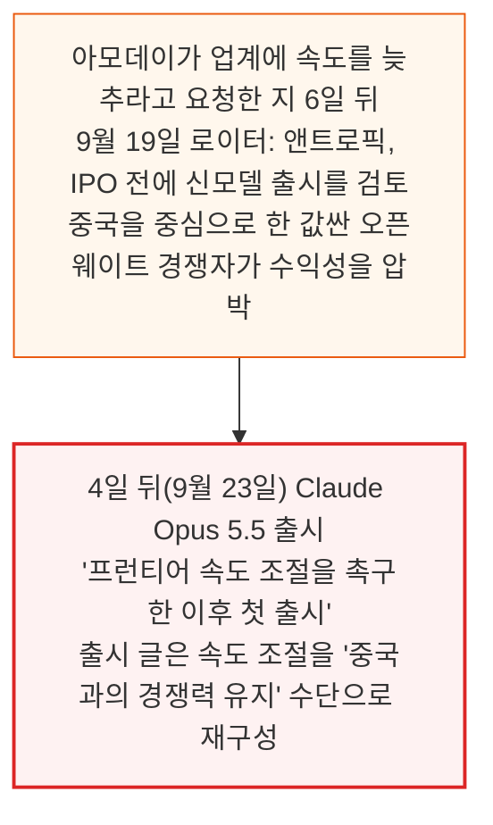

에세이를 쓴 사람조차 혼자서는 속도를 조절하지 못한다.

<a id="s8"></a>

## 8. 트럼프-시진핑 정상회담: 속도를 늦추자는 신호는 없었다

**📌 핵심:**
- 정상회담은 어느 쪽도 프런티어 속도를 조절할 뜻이 없다는 신호만 줬고, 프런티어 위험 관리에 대한 답은 최소였다
- 중국은 AI 대화를 무역 협의 틀 안에 두었고 중국 측 발표문 어디에도 MOST, CAC, TC260 인사가 없다
- 유일한 구체 성과는 사고 소통 채널이지만 무엇이 사고인지, 누가 받는지, 민간 랩이 어떻게 연결되는지는 정해지지 않았다
- 결론: 11월 선전의 2차 대화가 볼 대목이며, 무역 대화에 계속 묶여 있으면 프런티어 위험은 진지하게 다뤄지지 않을 것이다

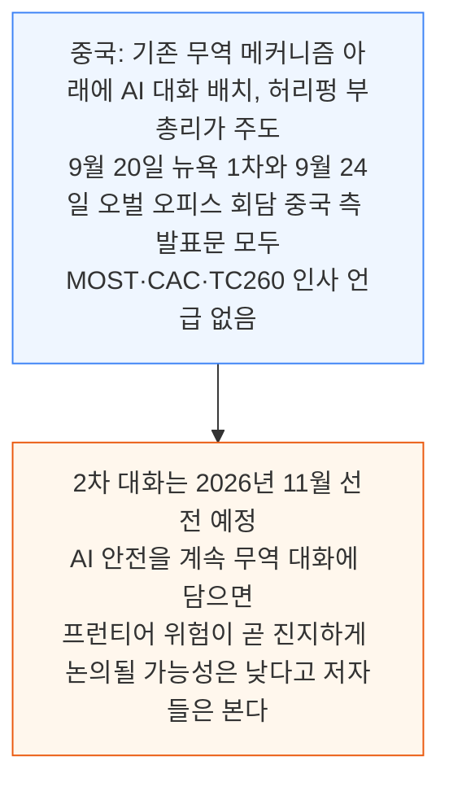

무역 채널로 대화를 이끌어도, 구속력 있는 프런티어 한도를 원하는 중국 과학자가 규칙을 쓰는 자리에 앉지 못한다는 사실은 바뀌지 않는다.

### 두 정상의 발언

- 트럼프: 미국은 "브레이크를 밟지 않을 것"이며 "통합은 하지 않는 편이 낫다"고 했다. 미국이 "최소 1년, 어쩌면 1년 반" 앞서 있기 때문이다
- 시진핑: 두 나라가 "서로 경계하기보다 각자의 강점을 발휘"하자고 했다. 수출통제를 겨냥한 말이다. 또 "AI의 오용과 악용을 함께 막고" 기술을 "인간 통제 아래" 두자고 했다
- 이는 베이징이 자체 거버넌스 문서에서 이미 쓰는 오용·통제 어휘이고 프런티어 문턱이 아니다

### 대화 이름조차 합의되지 않았다

- 미국은 정상들이 "'인공지능' 대신 '초지능'이라는 용어를 쓰기로 합의했다"고 말한다.
- 반면 중국의 8개 성과 목록은 여전히 "중미 AI 대화"라 부르며 처음부터 끝까지 "인공지능"을 쓴다.
- 외교부는 격차를 묻는 말에 중국이 미국의 단어 선택을 "존중한다"고 답했다.
- 9월 28일에는 베이징이 워싱턴과 베이징만이 아니라 유엔이 AI 거버넌스의 중심에 서기를 원한다고 덧붙였다.

### 유일한 구체 성과: 사고 채널

언론이 AI 핫라인이라 부른 이 채널은 미국 랩의 사고를 베이징으로, 중국 랩의 사고를 워싱턴으로 전달할 수 있는 최초의 정부 간 통로다. 그러나 무엇이 사고인지, 양쪽에서 누가 받는지, 첫 경보가 울릴 민간 랩이 어떻게 여기에 연결되는지는 아무도 밝히지 않았다.

<a id="s9"></a>

## 9. 미국 랩과 투자자에게 주는 시사점

**📌 핵심:**
- 미국 랩이 속도 조절에 합의해도 중국에서는 맞춰 줄 곳이 없다. 아모데이의 요청에 답한 중국 AI CEO는 없다
- 유일하게 답한 즈푸의 탕제는 속도를 늦추자는 것이 아니라 능력과 안전이 함께 나아가야 한다고 했다
- 중국은 응용 층은 계속 조이고 프런티어는 열어 둘 것이므로, 중국 모델이 뭘 할 수 있는지는 미국 랩이 오픈웨이트를 직접 시험해 알아야 한다
- 결론: 미국 투자자의 진짜 관문은 중국 규제가 아니라 2027년 초 재무부의 COINS Act 규칙이다

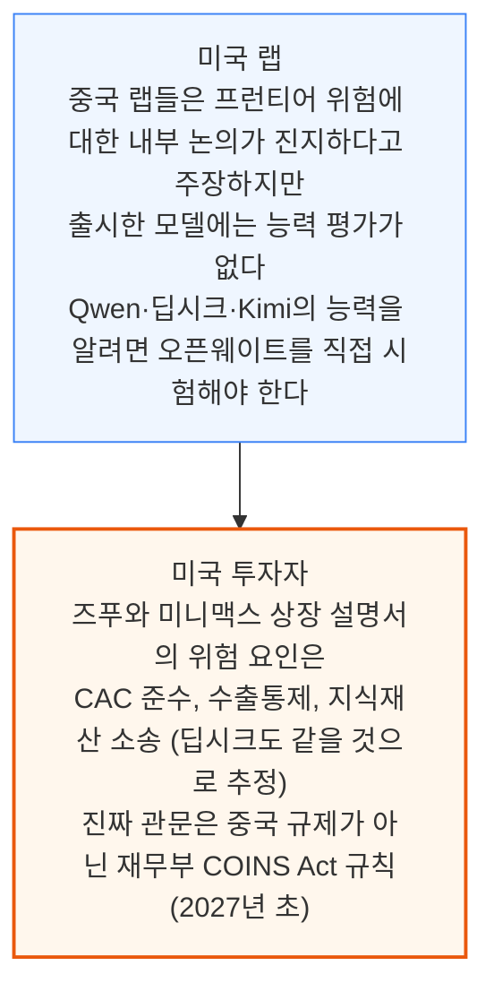

미중 AI 대화가 프런티어 안전에 의미를 가지려면 11월 회차에 TC260이나 CAC의 기술 인력이 들어와야 한다고 저자들은 본다.

<a id="s10"></a>

## 10. 앞으로 6개월의 날짜 박힌 시험

**📌 핵심:**
- 앞으로 6개월 안에 미국 국내, 지정학 일정, 2027년 초까지의 규제 문서로 나뉜 날짜 박힌 시험이 이어진다. 원문은 각 시험이 무엇을 알려 주고 무엇이 입장을 바꾸게 하는지를 표로 정리했다
- 미국에서는 연방정부가 속도 조절 제안에 반독점 면제도, 늦추는 랩에 대한 처벌도 내놓지 않았다
- 중국에서는 플래그십 출시마다의 안전 문서가 계속 확인할 지표다
- 결론: 2026년 프런티어 출시가 GLM-5.3 사이버 메모를 빼면 모두 출시 시점 안전 결과가 없었고, 이것이 이어지면 발전 우선, 안전은 곁다리, 프런티어는 손대지 않는다는 결론이 유지된다

### 시험 1: 미국

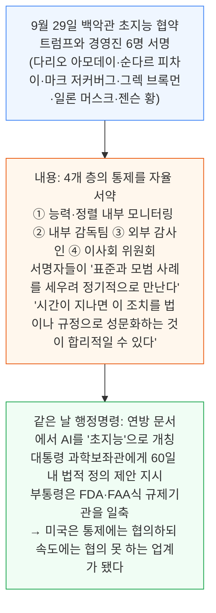

저자들이 볼 세 가지는 다음과 같다.

- 트럼프가 협약 감독자와 그가 거론한 약 10명 위원회에 누구를 지명하는가
- 홀리(Hawley)의 10월 1일 오픈AI 문서 제출 기한과 여러 주 법무장관의 공동 조사가 공개를 법적 의무로 바꾸는가
- 협약 아래 랩들의 "정기" 회동이 이름만 바꾼 속도 조절 포럼이 되는가

### 시험 2: 지정학 일정

- 트럼프가 11월 18\~19일 선전 APEC 정상회의에 참석하고, 같은 곳에서 미중 AI 대화 2차 회차가 예정돼 있다. 중국은 이 회의에서 APEC AI 이니셔티브를 성사시키려 한다
- 시진핑은 12월 마이애미 G20에 참석한다. 올해 트럼프-시진핑 만남이 네 번이 된다
- 베선트가 밝힌 다음 대화 의제에는 "통제 불능 에이전트"와 비국가 사이버·바이오 행위자가 들어 있다. 이는 통제 상실 어휘(원문 표기 WG9)다. 중국 대표단에 그 어휘로 글을 쓰는 사람이 있는지가 관건이다

### 시험 3: 2026년 말\~2027년

```mermaid
flowchart TD
    Y1["① 에이전트 응용 보안 의무 표준과 AI 위험 분류 표준<br/>프레임워크 3.0 부록 1의 통제 상실 통제(단계적 자율, 사람 승인 지점, 실패 시 기본 거부)가<br/>에이전트에 의무가 되면 중국 법규 최초의 구속력 있는 프런티어 인접 의무<br/>국가가 통제 상실 어휘를 의무로 바꾼 것이 된다"] --> Y2["② 미국 재무부 COINS Act 규칙(2027년 3월 13일까지)<br/>금지 대상 AI 투자를 정의하는 연산 임계값을 재설정<br/>공개시장 주식과 소극적 지분이 범위에 들어오는지 결정<br/>→ 미국 투자자의 중국 AI 상장 참여 가능 여부"]
    Y2 --> Y3["③ 포괄적 AI 입법 초안(2027년 3월 등장 시)<br/>연산·능력 임계값, 훈련 실행 등록, 출시 전 안전 사례,<br/>의무 사고 보고, 중단 명령권 중 하나라도 있는가<br/>중국 입법 교리를 쓰는 법학자들이 다섯을 모두 거부해 왔고<br/>저자들은 초안에 없을 것으로 예상"]
    style Y1 fill:#eff6ff,stroke:#3b82f6
    style Y2 fill:#fff7ed,stroke:#ea580c
    style Y3 fill:#fef2f2,stroke:#dc2626
```

이 모든 시험을 가로지르는 상시 지표는 플래그십 출시와 그 안전 문서다. GLM-5.3의 사이버 능력 메모를 빼면 2026년 프런티어 출시는 지금까지 모두 출시 시점 안전 결과 없이 나왔다. 이 상태가 이어지면 저자들의 발견이 유지된다. 발전이 먼저고, 안전은 곁에 있으며, 프런티어는 건드리지 않는다.

---

*작성 진행률: 약 100% 완료*
*업데이트: 전체 10개 섹션 변환 완료*
